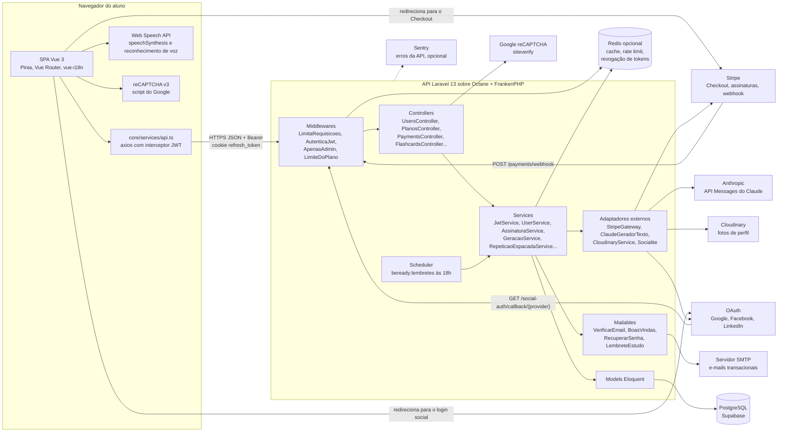
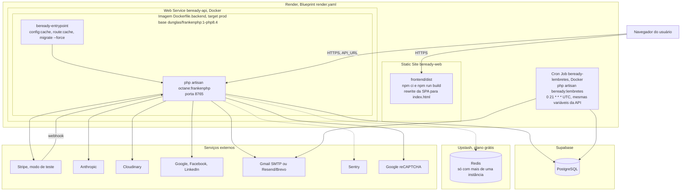

# Arquitetura

Base: `docs/arquitetura.md`, `Dockerfile.backend`, `Dockerfile.frontend`, `docker/entrypoint.sh`,
`backend/config/beready.php`, `backend/composer.json` e a seção 1 de `docs/roadmap-tcc.md`.

## Diagrama de componentes

O frontend é uma SPA em Vue 3 (Pinia, Vue Router, vue-i18n e axios) que conversa com a API REST
em Laravel 13 por HTTP/JSON. A API roda sobre o Laravel Octane com o servidor FrankenPHP. Dentro
da API, cada requisição passa pelos middlewares (`LimitaRequisicoes`, `AutenticaJwt`,
`ApenasAdmin`, `LimiteDoPlano`), depois controller, service e model Eloquent.

Os serviços externos ficam atrás de interfaces em `backend/app/Contracts/`
(`StripeGatewayInterface`, `GeradorTextoInterface`, `CloudinaryServiceInterface`), o que permite
trocá-los por implementações falsas nos testes.

Observações:

- Sem `REDIS_URL`, o cache fica em arquivo (`config/cache.php`), o que só funciona com uma instância
  da API. Com mais de uma instância, o Redis é obrigatório, porque guarda os contadores do rate
  limit e da IA, a lista de tokens revogados e os códigos do login social.
- A síntese e o reconhecimento de voz rodam no navegador. O servidor só recebe a frase esperada e
  o texto reconhecido, e calcula a nota (`PronunciaService`).
- O reCAPTCHA é gerado no navegador e conferido pela API no cadastro e no login
  (`UsersController::checarRecaptcha`).

## Diagrama de implantação

Arquitetura da seção 1 do roadmap, como descrita no Blueprint do Render (`render.yaml`) e em
`docs/deploy-render.md`. O Railway é a alternativa citada no roadmap; o Blueprint cobre só o
Render. A API sobe com a imagem `Dockerfile.backend --target prod`. O `docker/entrypoint.sh` roda
`config:cache`, `route:cache` e `migrate --force` antes do Octane. O frontend é publicado como site
estático a partir de `frontend/dist`.

No `render.yaml`, o lembrete roda como um Cron Job próprio (`beready-lembretes`), com a mesma
imagem e o grupo de variáveis da API, chamando `php artisan beready:lembretes` uma vez por dia às
21h UTC (18h em Brasília). Fora do Render, a alternativa é um cron chamando
`php artisan schedule:run` a cada minuto, que dispara o mesmo comando pelo agendador do Laravel.

[preencher: URLs públicas da API e do frontend depois do deploy.]

Variáveis de produção que mudam em relação ao ambiente local (seção 1 do roadmap):
`APP_ENV=production`, `APP_DEBUG=false`, `APP_KEY` e `JWT_SECRET` novos, `APP_URL`,
`APP_BASE_URL`, `CORS_ALLOWED_ORIGINS` só com a URL do frontend, `REFRESH_COOKIE_SECURE=true`,
`REFRESH_COOKIE_SAMESITE=None` quando frontend e API estão em domínios diferentes,
`TRUSTED_PROXIES=*`, `REDIS_URL` (se houver mais de uma instância) e `SENTRY_LARAVEL_DSN`
(opcional). No frontend, o build recebe `VITE_API_URL` e `VITE_RECAPTCHA_SITE_KEY`.
