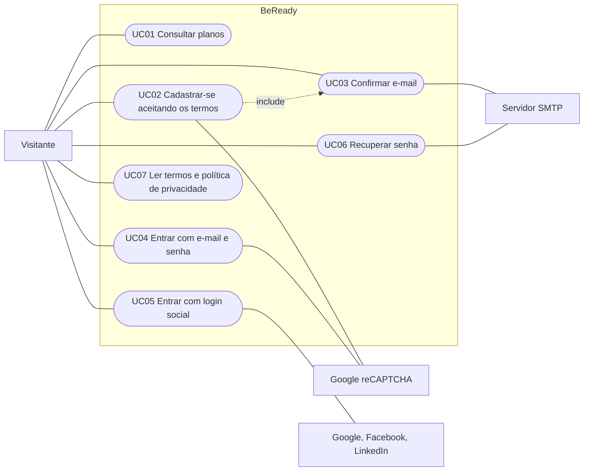
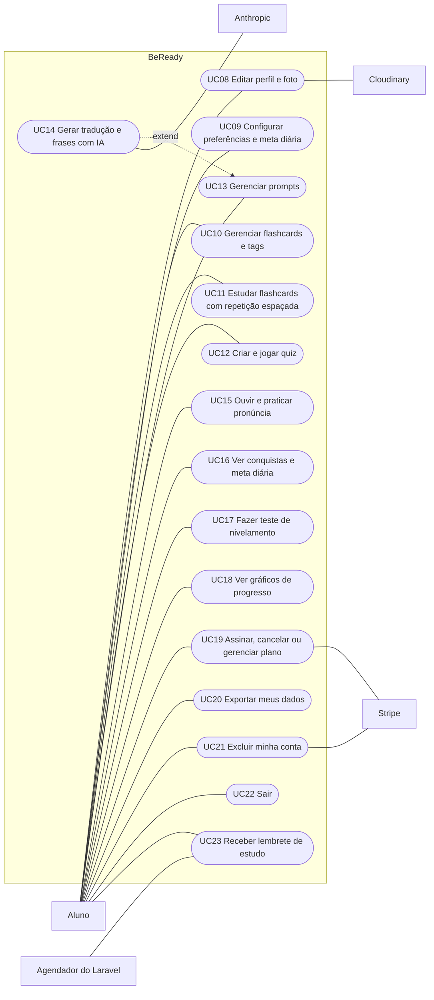
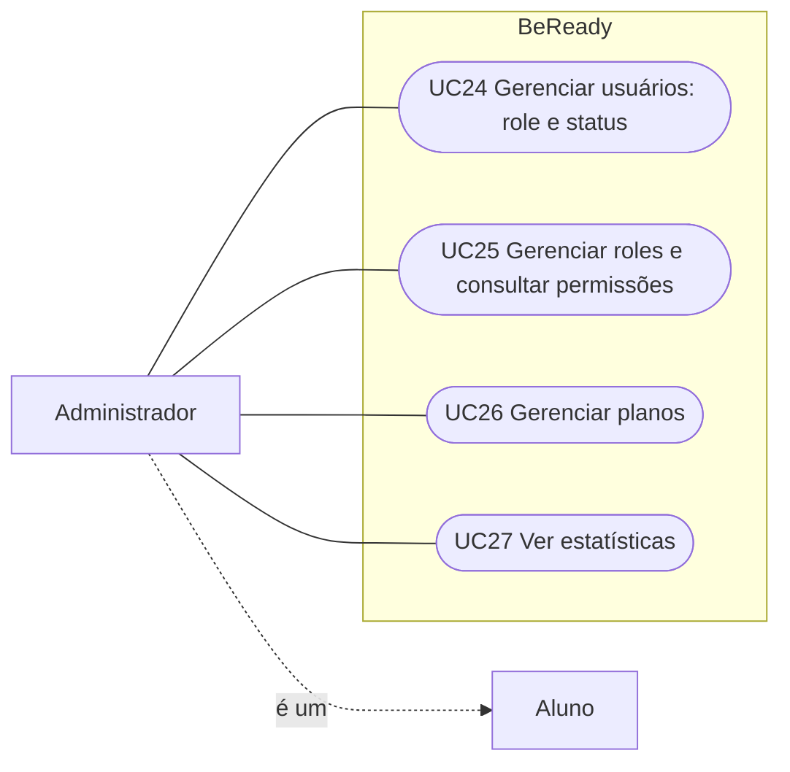

# Casos de uso

Base: `backend/routes/api.php` (rotas da API) e `frontend/src/router/index.ts` (telas).

O Mermaid não tem diagrama de casos de uso. Os diagramas abaixo usam `flowchart`: atores como
retângulos à esquerda, casos de uso como elementos arredondados (estádio) dentro da fronteira do
sistema. Para caber na página, o diagrama foi dividido em três: visitante, aluno e administrador.

Atores:

- **Visitante:** pessoa sem sessão. Vê as páginas públicas, cria conta e entra.
- **Aluno:** usuário autenticado com role `user`. Usa as funções de estudo dentro dos limites do
  plano (`LimiteDoPlano`).
- **Administrador:** usuário com role `admin` no banco (`ApenasAdmin`). Faz tudo o que o aluno faz
  e também acessa `/admin/*`.
- Atores secundários (sistemas): Stripe, Anthropic, provedores OAuth, Google reCAPTCHA, servidor
  SMTP e o agendador do Laravel (`schedule:run`).

## Visitante

## Aluno

## Administrador

## Descrição dos casos de uso

| Caso | Ator | Descrição | Rotas da API | Tela |
|---|---|---|---|---|
| UC01 Consultar planos | Visitante, Aluno | Lista os planos ativos com preços mensal e anual, recursos e limites. | `GET /planos` | `/planos` |
| UC02 Cadastrar-se aceitando os termos | Visitante | Informa nome, e-mail e senha (mínimo 6 caracteres) e marca o aceite obrigatório dos termos e da política. O reCAPTCHA é conferido no servidor. Grava `termos_versao` e `termos_aceitos_em`, ativa o plano gratuito e envia o link de confirmação. | `POST /auth/register` | `/register` |
| UC03 Confirmar e-mail | Visitante | Abre o link recebido (token de 24 horas, só o hash SHA-256 fica no banco). Na primeira confirmação recebe o e-mail de boas-vindas. Pode pedir um novo link. | `POST /auth/verify-email`, `POST /auth/resend-verification` | `/verificar-email/:token` |
| UC04 Entrar com e-mail e senha | Visitante | Login com reCAPTCHA. Conta sem e-mail confirmado recebe 403 com `codigo` para oferecer o reenvio. Recebe o access token no JSON e o refresh token em cookie httpOnly. | `POST /auth/login`, `POST /auth/refresh` | `/login` |
| UC05 Entrar com login social | Visitante | Redireciona ao Google, Facebook ou LinkedIn (Socialite). O callback gera um código de uso único que a SPA troca pelos tokens. A foto do perfil social é copiada para o Cloudinary. | `GET /auth/login/{provider}`, `GET /social-auth/callback/{provider}`, `POST /auth/social/exchange` | `/oauth-callback` |
| UC06 Recuperar senha | Visitante | Recebe por e-mail um link com token; define a senha nova. | `POST /auth/forgot-password`, `POST /auth/reset-password/{token}` | `/forgot-password`, `/reset-password/:token` |
| UC07 Ler termos e política de privacidade | Visitante, Aluno | Páginas estáticas com os dados coletados, a base legal, os compartilhamentos e os direitos do titular. | nenhuma | `/termos`, `/privacidade` |
| UC08 Editar perfil e foto | Aluno | Altera dados do perfil e o idioma da interface. A troca de senha exige a senha atual e revoga os tokens antigos. A foto vai para o Cloudinary. | `GET /users/me`, `PUT /users/update/{id}`, `POST /upload/profile-photo` | `/profile`, `/profile/edit` |
| UC09 Configurar preferências e meta diária | Aluno | Tema (claro, escuro, daltônico), som, notificações, meta de cards por dia (5, 10, 20 ou 30). | `GET /preferencias/usuario/{id}`, `POST /preferencias` | `/preferencias` |
| UC10 Gerenciar flashcards e tags | Aluno | CRUD de flashcards e tags e associação entre eles. A criação respeita o limite do plano. | `/flashcards`, `/tags`, `/flashcard-tags` | `/flashcards`, `/flashcards/:id`, `/tags` |
| UC11 Estudar flashcards com repetição espaçada | Aluno | Lista os cards vencidos e registra a avaliação (`errei`, `bom`, `facil`). O servidor calcula a próxima revisão (SM-2 simplificado). | `GET /flashcards/revisao`, `POST /flashcards/{id}/revisao` | `/flashcards/revisao`, `/flashcards/:id/study` |
| UC12 Criar e jogar quiz | Aluno | Cria quiz manual ou gerado a partir dos próprios flashcards (frente como enunciado, versos de outros cards como distratores). Joga quizzes próprios ou públicos; a correção é feita no servidor. | `POST /quizes`, `POST /quizes/gerar`, `/quizes/{id}/questoes`, `POST /quizes/{id}/questoes/{questaoId}/verificar`, `POST /quizes/{id}/finalizar` | `/quizes`, `/quizes/add`, `/quizes/:id/play` |
| UC13 Gerenciar prompts | Aluno | Cadastra textos (prompts) e vê traduções, frases semelhantes e imagens ligadas a eles. | `/prompts`, `/traducoes`, `/frases`, `/imagens` | `/prompts`, `/prompts/:id` e subpáginas |
| UC14 Gerar tradução e frases com IA | Aluno | Gera uma tradução ou de 1 a 10 frases semelhantes com o Claude a partir do texto do prompt (até 2000 caracteres), com teto diário por usuário (`IA_LIMITE_DIARIO`, padrão 50). | `POST /prompts/{id}/traducoes/gerar`, `POST /prompts/{id}/frases/gerar` | `/prompts/:promptId/traducoes`, `/prompts/:promptId/frases` |
| UC15 Ouvir e praticar pronúncia | Aluno | Ouve frases pela síntese de voz do navegador (velocidade normal ou lenta). No exercício "Repita a frase", o reconhecimento de voz do navegador transcreve a fala e o servidor dá a nota pela maior sequência comum de palavras. | `GET /pronuncia/frases`, `POST /pronuncia/tentativas`, `GET /pronuncia/resumo` | `/pronuncia` |
| UC16 Ver conquistas e meta diária | Aluno | Vê as 8 conquistas (avaliadas no servidor ao listar e ao jogar quizzes), marca os avisos como vistos e acompanha a meta do dia no dashboard. | `GET /conquistas`, `POST /conquistas/vistas`, `GET /meta-diaria` | `/conquistas`, `/dashboard` |
| UC17 Fazer teste de nivelamento | Aluno | Teste adaptativo de 12 questões, começando no B1. O resultado (A1 a C1) vira o `nivel_ingles`; só pode refazer depois de 30 dias. | `POST /nivelamento/iniciar`, `POST /nivelamento/{id}/responder`, `GET /nivelamento/resultado` | `/nivelamento` |
| UC18 Ver gráficos de progresso | Aluno | Revisões por dia, taxa de acerto e nota de pronúncia por semana e distribuição dos cards, cada gráfico com tabela equivalente. | `GET /progresso/historico`, `GET /progresso/usuario/{id}` | `/progresso` |
| UC19 Assinar, cancelar ou gerenciar plano | Aluno | Plano pago abre o Checkout do Stripe; o webhook ativa a assinatura. Plano gratuito ou trial ativa direto. Cancelamento recorrente vale no fim do período. O portal do Stripe gerencia o pagamento. | `POST /planos/{id}/assinar`, `POST /planos/cancelar`, `POST /planos/portal`, `GET /user/assinatura`, `POST /payments/webhook` | `/planos`, `/dashboard` |
| UC20 Exportar meus dados | Aluno | Baixa um JSON com perfil, flashcards, quizzes, prompts, progresso, preferências e histórico de assinaturas (LGPD). | `GET /users/me/exportar` | `/profile` |
| UC21 Excluir minha conta | Aluno | Confirma com a senha. A API cancela as assinaturas no Stripe, apaga os dados e revoga todos os tokens. Conta de administrador não pode ser excluída. | `DELETE /users/delete/{id}` | `/profile` |
| UC22 Sair | Aluno | Revoga o refresh token do cookie e o apaga. | `POST /auth/logout` | menu |
| UC23 Receber lembrete de estudo | Agendador, Aluno | Todos os dias às 18h, `beready:lembretes` envia e-mail a quem tem cards vencidos e parou de estudar, se as notificações estiverem ativas. | nenhuma (comando Artisan) | nenhuma |
| UC24 Gerenciar usuários | Administrador | Lista usuários, muda a role (`user` ou `admin`) e o status. Não pode rebaixar a si mesmo. Pelo `PUT /users/update/{id}`, a mudança de role ou status revoga os tokens do usuário; o `POST /admin/users/role` só grava a role, e o acesso a `/admin/*` é sempre conferido no banco. | `GET /admin/users`, `POST /admin/users/role`, `PUT /users/update/{id}` | `/admin` |
| UC25 Gerenciar roles e consultar permissões | Administrador | CRUD de roles e consulta das permissões. | `/admin/roles`, `GET /admin/permissions` | `/admin` |
| UC26 Gerenciar planos | Administrador | CRUD de planos: preços, trial, recursos, limites e a role associada. | `/admin/planos`, `/admin/planos/edit/{id}`, `/admin/planos/delete/{id}` | `/admin` |
| UC27 Ver estatísticas | Administrador | Números gerais do sistema. | `GET /admin/stats` | `/admin` |
