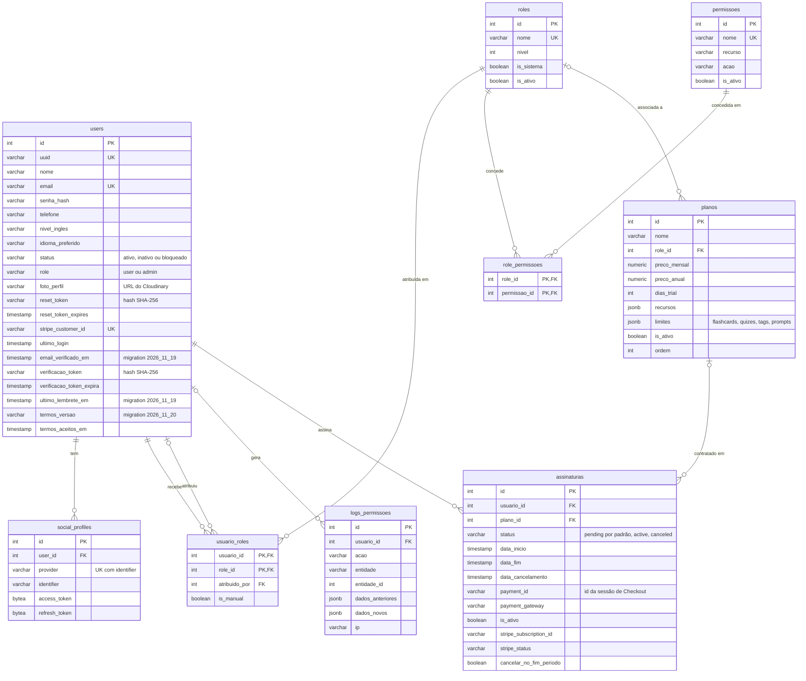
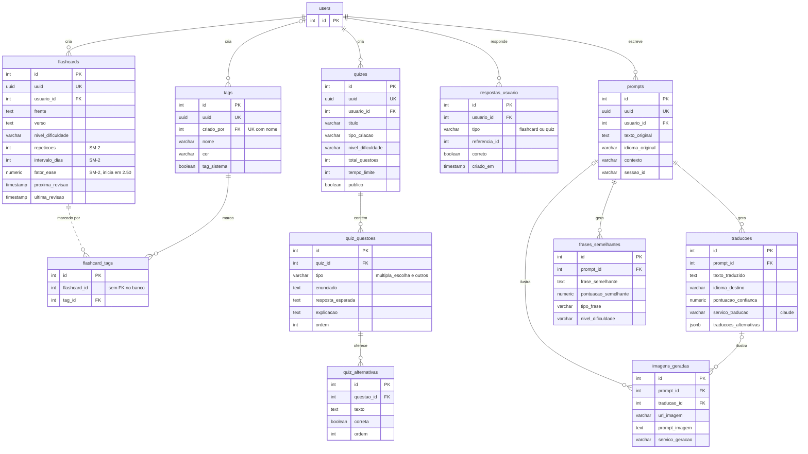
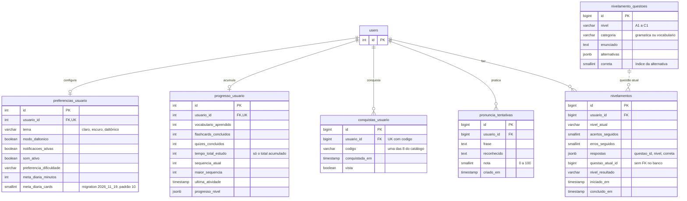

# Modelo de dados (DER)

Base:

- `backend/database/schema/esquema-inicial.sql`, carregado pela migration
  `0001_01_01_000000_esquema_inicial.php` (esquema herdado da versão em CakePHP);
- `2026_11_19_000000_adiciona_verificacao_de_email.php`;
- `2026_11_19_000001_cria_pronuncia_tentativas.php`;
- `2026_11_19_000002_cria_gamificacao.php`;
- `2026_11_20_000000_cria_nivelamento.php`;
- `2026_11_20_000001_registra_aceite_dos_termos.php`.

Ficaram de fora as tabelas da fila do Laravel (`jobs`, `job_batches`, `failed_jobs`, da migration
`0001_01_01_000002_create_jobs_table.php`) e a tabela de controle `migrations`, que não fazem
parte do domínio.

São 26 tabelas de domínio, divididas em três diagramas. A tabela `users` aparece nos três, só com
a chave primária nos dois últimos. Cada diagrama mostra as chaves e as colunas principais; as
colunas de data de criação e atualização foram omitidas quando não têm regra de negócio.

Convenções: `PK` chave primária, `FK` chave estrangeira com restrição no banco, `UK` índice
único. Relações tracejadas são lógicas, sem restrição de chave estrangeira no banco.

## 1. Usuários, acesso e planos

## 2. Estudo: flashcards, quizzes, prompts e IA

## 3. Acompanhamento, gamificação e nivelamento

## Observações sobre o esquema

- **Exclusão em cascata:** quase todas as FKs para `users` são `ON DELETE CASCADE`, o que sustenta
  a exclusão da conta (LGPD). As exceções são `tags.criado_por` (`SET NULL`), `logs_permissoes` e
  `usuario_roles.atribuido_por` (sem ação). `imagens_geradas` usa `SET NULL` para prompt e
  tradução.
- **Repetição espaçada:** o estado do SM-2 fica no próprio flashcard (`repeticoes`,
  `intervalo_dias`, `fator_ease`, `proxima_revisao`, `ultima_revisao`).
- **`respostas_usuario`:** relação polimórfica. `tipo` (`flashcard` ou `quiz`) diz se `referencia_id`
  aponta para um flashcard ou um quiz, por isso não há FK. No quiz, grava uma linha por questão
  respondida. É a base dos gráficos de revisões e acerto.
- **Tokens:** os tokens de verificação de e-mail e de recuperação de senha ficam só como hash
  SHA-256. O refresh token JWT não é gravado no banco; a revogação fica no cache
  (ver `sequencias.md`). As colunas `users.token` e `users.token_expires` vêm do esquema herdado.
- **Tags:** o nome é único por dono (`tags_criado_por_nome_key`) e, entre as tags sem dono, único
  globalmente (`tags_sem_dono_nome_key`). Os dois são índices parciais.
- **Tempo de estudo:** `progresso_usuario.tempo_total_estudo` guarda só o total. Não há registro
  por sessão, por isso o gráfico de tempo por semana ficou para trabalhos futuros.
