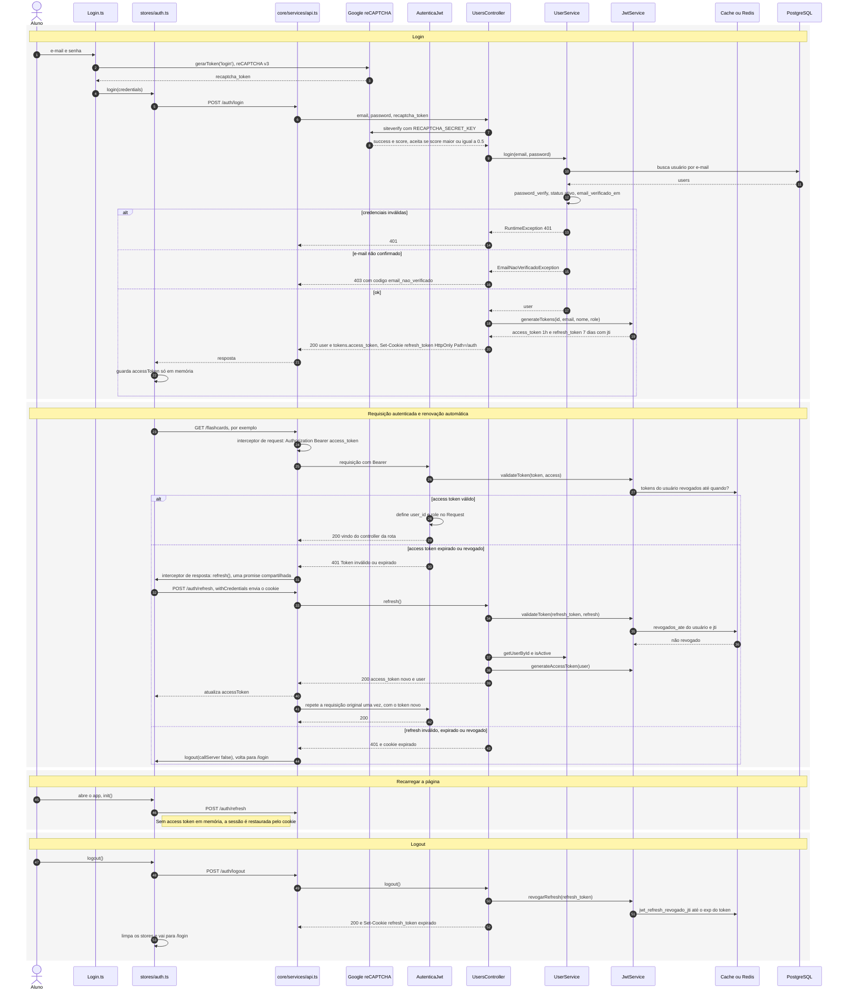
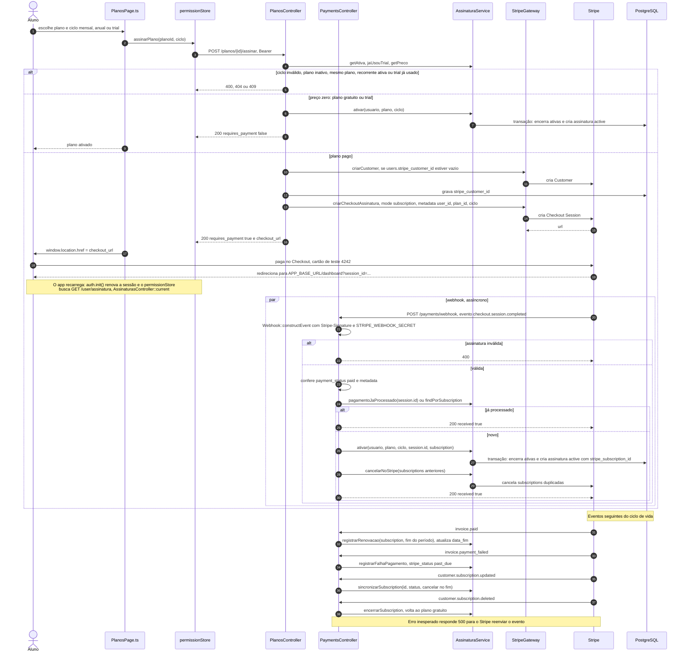
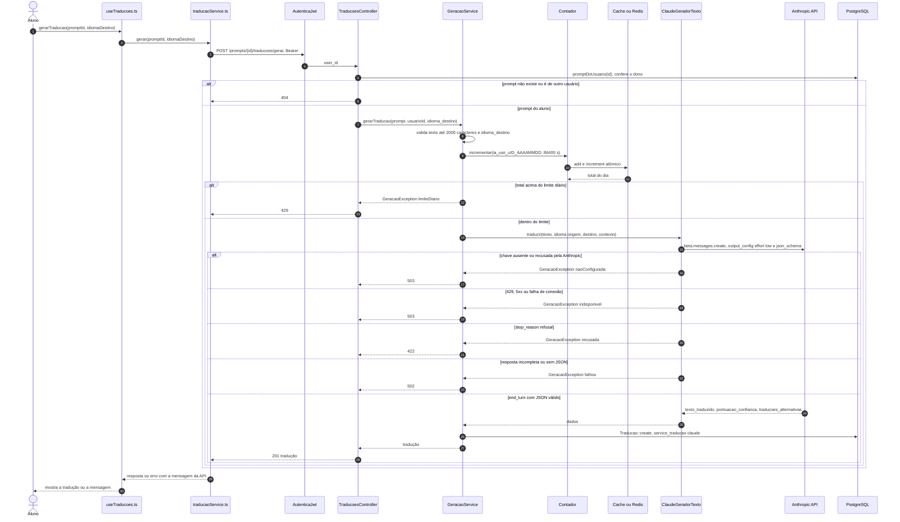
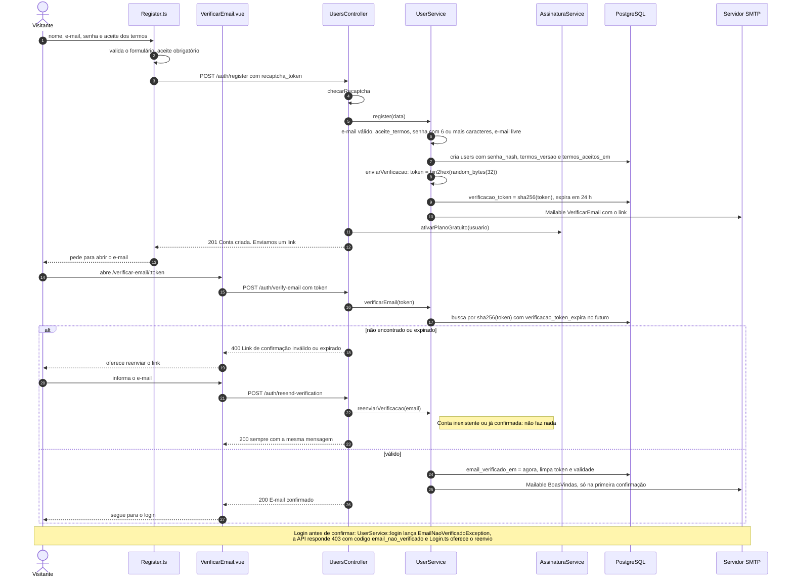

# Diagramas de sequência

Base: `backend/routes/api.php`, `backend/app/Http/Controllers/UsersController.php`,
`PlanosController.php`, `PaymentsController.php`, `TraducoesController.php`,
`backend/app/Services/` (`JwtService`, `UserService`, `AssinaturaService`, `GeracaoService`,
`ClaudeGeradorTexto`), `backend/app/Http/Middleware/AutenticaJwt.php`,
`frontend/src/core/services/api.ts`, `frontend/src/stores/auth.ts`,
`frontend/src/stores/permissionStore.ts` e as telas em `frontend/src/modules/auth/views/`.

Todas as requisições passam antes pelo `LimitaRequisicoes` (300 por minuto por IP e 10 por minuto
nas rotas `/auth/*`). Para não repetir, os diagramas só mostram esse middleware onde ele importa.

## 1. Login com refresh token

O access token (JWT, 1 hora) fica só em memória, no store `auth` do Pinia. O refresh token (JWT,
7 dias, com `jti` aleatório) vai só no cookie `refresh_token`, com `HttpOnly` e `Path=/auth`; o
JavaScript da página não consegue lê-lo. Valores em `backend/config/beready.php`.

O `POST /auth/refresh` devolve só um access token novo. O refresh token não é trocado a cada uso;
um par novo só é emitido no login e quando o próprio usuário troca a senha. A revogação usa o
cache (Redis em produção): `revogarRefresh` grava o `jti` no logout, e `revogarTodos` grava o
instante a partir do qual tokens mais antigos do usuário deixam de valer (troca de senha,
bloqueio, mudança de role, exclusão da conta).

## 2. Assinatura com o webhook do Stripe

A ativação de um plano pago só acontece pelo webhook, que é a fonte confiável (o retorno do
navegador para `success_url` não ativa nada). O webhook é público, mas o corpo só é aceito com uma
assinatura `Stripe-Signature` válida para o `STRIPE_WEBHOOK_SECRET`. O Stripe pode reenviar o
mesmo evento, por isso `checkoutConcluido` confere se a sessão ou a subscription já foram
processadas.

No `customer.subscription.deleted`, o `encerrarSubscription` marca a assinatura como `canceled`,
`is_ativo = false`, grava `data_cancelamento` e, se ela estava ativa, chama
`ativarPlanoGratuito` na mesma transação.

## 3. Geração por IA

A tradução e as frases semelhantes são geradas a partir do texto de um prompt do próprio aluno. O
`GeracaoService` conta a tentativa antes de chamar o provedor, e a tentativa conta mesmo se o
provedor falhar, porque é a chamada que custa. O contador é diário, por usuário, no cache
(`Contador::incrementar`, atômico no Redis). O teto é `IA_LIMITE_DIARIO`, com padrão de 50.

O `ClaudeGeradorTexto` usa a API Messages pelo SDK `anthropic-ai/sdk`, com o modelo de
`ANTHROPIC_MODEL`, saída estruturada em JSON Schema, esforço baixo e fallback do servidor.

As frases semelhantes seguem o mesmo caminho: `POST /prompts/{id}/frases/gerar` com
`quantidade` de 1 a 10 (padrão 5), `FrasesSemelhantesController`, `GeracaoService::gerarFrases`,
`ClaudeGeradorTexto::frasesSemelhantes` e uma linha em `frases_semelhantes` por frase.

## 4. Verificação de e-mail

O token é aleatório (32 bytes em hexadecimal), vale 24 horas e só o hash SHA-256 fica em
`users.verificacao_token`. O link aponta para o frontend (`APP_BASE_URL` +
`verificar-email/{token}`), que chama a API. O reenvio responde sempre a mesma mensagem, para não
revelar quais e-mails têm conta.

Contas criadas antes desta funcionalidade foram marcadas como verificadas pela migration
`2026_11_19_000000_adiciona_verificacao_de_email.php`, para ninguém perder o acesso.
